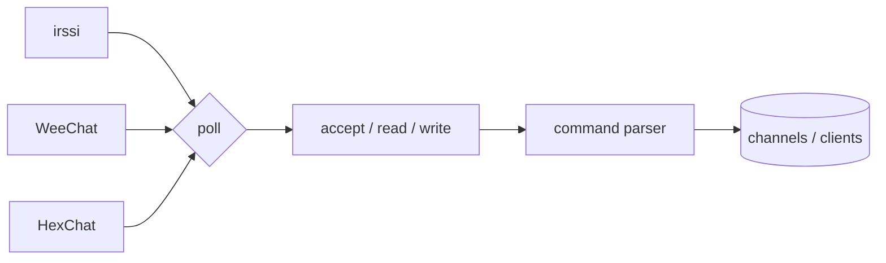

**Junior software & security engineer.** C/C++ systems, networking, Python.
Student at **1337 (42 Network)**, Morocco · Open to **remote roles, internships & freelance**.

---

## 👋 About

- 🛠️ I write low-level **C/C++**: manual memory management, sockets, processes, signals. Debugging with Valgrind, ASan, gdb.
- 🌐 I build network services from scratch and inspect them with Wireshark and Nmap.
- 🔐 I practice web/network pentesting on Hack The Box and I'm working toward **CJCA**.
- 🐍 I automate with **Python** and Bash: [one specific tool you built].

---

## 🚀 Projects

<table>
  <tr>
    <td width="50%" align="center">
      
       <b>cub3D</b> 
      DDA raycasting engine in C · textured walls · [minimap]
    </td>
    <td width="50%" align="center">
      
       <b>ft_IRC</b> 
      C++98 server · poll() · non-blocking I/O · [N] clients
    </td>
  </tr>
  <tr>
    <td width="50%" align="center">
      
       <b>C Garbage Collector</b> 
      Mark-and-sweep in C · [how roots are found]
    </td>
    <td width="50%" align="center">
      
       <b>Minishell</b> 
      Parser · pipes · redirections · heredocs · signals
    </td>
  </tr>
</table>

Also: [Inception](https://github.com/HamzaBenMohamd/Inception): NGINX + WordPress + MariaDB with Docker Compose, TLS, persistent volumes.

### How ft_IRC handles clients

---

## 🔐 Security

- Hack The Box: [X] machines rooted · [rank]
- [Best write-up title]: [one-line technique]

<b>Write-ups</b>

- [Box: technique](https://github.com/HamzaBenMohamd/htb-writeups/tree/main/machines/BOX)
- [Box: technique](https://github.com/HamzaBenMohamd/htb-writeups/tree/main/machines/BOX)

---

## 🔨 Right now

- Building [current project + link]
- Preparing for HTB **CJCA**
- Writing Python tooling for [recon / automation, be specific]

---

## 🤝 Work with me

A good fit if you need a junior who writes careful C/C++, understands what's under the abstraction, and ships.

**Available:** [remote / internship / freelance] · [hours/week] · UTC+1
**Languages:** Arabic, French, English
**Contact:** [you@mail.com](mailto:you@mail.com)

<picture>
  <source media="(prefers-color-scheme: dark)" srcset="https://raw.githubusercontent.com/HamzaBenMohamd/HamzaBenMohamd/output/github-snake-dark.svg">
  
</picture>

